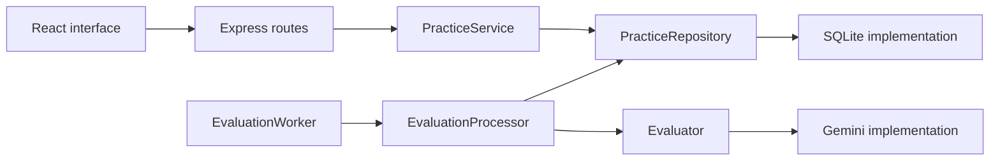

# LLD Practice Platform: design note

Implementation reviewed 15 October 2026. This note describes the implemented MVP and distinguishes future extensions from current behaviour.

## Learner need and MVP

The platform helps a learner explain an object-oriented design, receive actionable feedback, and improve through another attempt. A useful submission includes reasoning about responsibilities and interactions so feedback can address more than a list of class names.

The MVP provides Parking Lot, Vending Machine, and Library Management problems; one demo learner; and Problems, Practice, and History screens. Each answer has five text sections: requirements/assumptions, classes/responsibilities, relationships/interactions, edge cases/testing, and trade-offs. Text captures these decisions with a small implementation scope and permits supporting pseudocode. It cannot verify executable behaviour or replace diagrams where visual structure matters.

The flow is **choose problem → draft → submit → review feedback → revise**. Drafts can be saved incomplete. Submission requires all five sections and at most 6,000 Unicode code points in total, including whitespace. Submitted answers become read-only. History supports reopening drafts, reviewing previous feedback, and following revision links. Authentication, code execution, diagram editing, and side-by-side comparison are outside this MVP.

## Architecture and responsibilities

The modular monolith uses React/TypeScript, an Express API, and SQLite. One Node process serves the built interface and API and runs a sequential evaluation worker. HTTP handlers translate requests; application services coordinate work; domain objects enforce behaviour; infrastructure implements storage and provider access. Domain code has no dependency on React, Express, SQLite, or Gemini.

| Domain object | Responsibility and important behaviour |
| --- | --- |
| `Problem` | Immutable statement, requirements, problem version, and rubric reference. Existing attempts retain their selected version. |
| `Attempt` | Owns the editable draft. `updateDraft` and `submit` enforce its lifecycle; `revise` creates a new draft from a submitted answer. |
| `Submission` | Validates and freezes the accepted answer, ownership, problem/rubric references, and submission format/version. |
| `Evaluation` | Owns one run against a submission: start, complete, fail, or create a separate retry. Completed feedback and failed runs remain historical records. |
| `Rubric` | Defines five criteria and validates returned labels, coverage, explanations, suggestions, evidence, and priority limits. |

Feedback is an immutable value composed of assessments, evidence, and priority improvements. Shared text validation lives in `design.ts`; it needs no stateful validator class.

`PracticeService` coordinates learner actions through the `PracticeRepository` interface. The repository exposes operations such as atomic submission and queue claiming, rather than forcing the service to assemble transactions from independent table writes. `SqlitePracticeRepository` implements that boundary.

`EvaluationProcessor` processes one claimed run through the `Evaluator` interface. `GeminiEvaluator` implements provider communication; `EvaluationWorker` owns scheduling. This separates evaluation policy from polling and lets tests supply an offline evaluator.

## Submission, persistence, and failures

An attempt has at most one submission; a submission can have multiple evaluation runs. A revision links a new attempt to its predecessor. A retry links a new evaluation to its failed predecessor while keeping the same submission, rubric, and evaluator identity. These are separate operations because revising changes the learner's answer, while retrying evaluates the saved answer again.

Submitting commits the attempt transition, immutable submission, and queued evaluation in one SQLite transaction. The API then returns the saved state; the browser polls for feedback. Model requests occur outside database transactions.

The worker claims one queued run atomically, loads its saved context, and changes it to `evaluating`. Valid feedback produces `completed`; errors produce `failed` with a safe message. The adapter permits one provider request per run, uses a 30-second timeout, and supports cancellation. Retries are explicit learner actions; no automatic repair or fallback request is made.

Five tables store problems, rubrics, attempts, submissions, and evaluations. Answer and feedback content use JSON; identifiers, relationships, lifecycle states, and timestamps use regular columns. Foreign keys, uniqueness constraints, immutable-history triggers, and revision checks protect consistency. Stale saves and repeated submissions are rejected. Identical HTTP requests do not replay a previous successful response.

At restart, never-started queued work can proceed. Runs left `evaluating` become failed and require manual retry because the process may have stopped after the provider handled the request. A fatal worker persistence error stops the API. Recovery assumes one application process per database.

## Evaluation and useful feedback

Deterministic rules establish completeness, valid transitions, version compatibility, and response integrity. Gemini 3.8 Flash assesses requirements coverage, class responsibilities, relationships/interfaces, extensibility/trade-offs, and edge cases/testability. These judgements can involve several defensible solutions.

Each criterion receives **Strong**, **Needs improvement**, or **Insufficient evidence**, with an explanation and suggestion. Strong and Needs improvement require a literal quotation from a named answer section. At most three overall improvements keep the next revision focused. Labels avoid suggesting numerical precision.

The prompt supplies trusted problem/rubric context separately from JSON-encoded learner text, marks embedded learner instructions as untrusted, and asks the model to assess justified alternatives fairly. A JSON schema constrains output; domain validation checks every criterion exactly once, allowed labels, required text, and evidence quotations. Quote matching establishes that evidence exists, not that the judgement is correct. Prompt-injection resistance is not guaranteed.

Requests use LOW thinking and a 1,200-output-token cap. Inputs contain the current answer and saved problem/rubric, without previous attempts or feedback. The project targets a Free Tier account with billing disabled; the application cannot verify account billing status. Credentials remain server-side. A labelled simulated preview supports demonstrations without provider calls.

## Trade-offs and extension points

The single-process worker and SQLite keep setup small and submissions durable, but synchronous storage and sequential evaluation limit throughput. If demand grows, evaluation execution is the first component to separate. Doing so requires job ownership and recovery coordination; the current restart policy cannot safely supervise several workers.

Another automated evaluator can implement `Evaluator` without changing learner actions. The existing Gemini, historical Groq, and simulated implementations demonstrate that boundary. The processor checks the saved evaluator identity, so historical runs cannot silently switch providers. Human review would additionally need assignment and later completion actions; it should not occupy the current worker while waiting for a reviewer.

A diagram format would require a versioned content union, format-specific draft/submission validation and editors, updated storage constraints and migration, and evidence references suitable for diagram elements. The current text types are deliberately concrete. Submission immutability and evaluation/revision lifecycles provide reusable behaviour, but format support is not a configuration-only change.

Problem and rubric versions are persisted. Production evaluations currently retain the provider ID but not a complete model/prompt configuration snapshot; adding that metadata would improve auditability after future evaluator changes. Other limits include one demo identity, explicit draft saves, external-provider availability, and limited validation of feedback quality.

## Validation evidence

The latest completed checks passed 146 offline backend tests, backend/frontend TypeScript checks, and the production build. Nine browser tests previously passed against the simulated preview. Coverage includes revision/history preservation, transaction rollback, stale writes, duplicate processing, invalid provider output, timeout/cancellation, manual retries, and restart recovery.

One live Parking Lot evaluation completed through the production adapter and processor. All five assessments passed domain validation and remained completed after reopening SQLite. Usage was 1,056 input tokens and 770 output tokens, 1,826 total. This verifies one live example; broader consistency, alternative-design fairness, and injection-resistance evaluation remain future work. See the [live result](gemini-recovery-check.md), [API contract](api-contract.md), and [setup instructions](../README.md).
