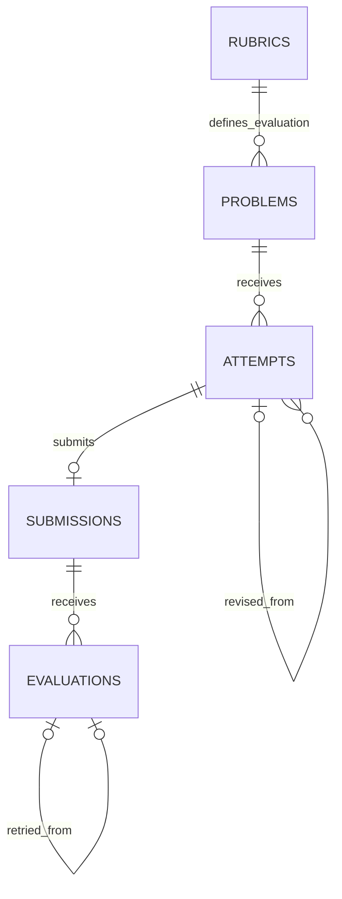

# SQLite storage design

Status: approved and implemented. The evaluation processor, background scheduling, startup recovery, and React interface are also implemented. Live feedback quality remains untested.

## Tables and relationships

| Table | Identity | Stored information |
| --- | --- | --- |
| rubrics | version | Criteria and allowed labels as JSON; creation time |
| problems | id + version | Title, description, requirements JSON, rubric version, creation time |
| attempts | id | Learner, problem/rubric versions, draft JSON, status, previous attempt, revision counter, timestamps |
| submissions | id; unique attempt_id | Immutable submitted sections, format/version, learner and problem/rubric versions, submission time |
| evaluations | id | Submission, rubric version, evaluator, status, feedback JSON or failure, previous evaluation, revision counter, timestamps |

The database keeps problem and rubric versions so a later change does not rewrite the context of older attempts. Draft answers and feedback reports are stored as JSON because the current flow reads each as a whole. IDs, statuses, versions, and timestamps remain regular columns for filtering and integrity checks.

## Submitting atomically

One SQLite transaction checks the draft revision, marks the attempt submitted, inserts the immutable submission, and inserts its queued evaluation. If any operation fails, every write in that transaction rolls back. The repository never invokes the LLM inside a transaction.

The application database is `data/practice.sqlite`. Run `npm run db:init` from the project folder to initialize it. The command and API startup seed the agreed rubric and the three selected problem statements. Identical saved versions are retained; no learner attempts, submissions, or evaluation results are seeded. Application tables contain no test fixtures.

## Protecting history

- SQL constraints enforce one submission per attempt and matching ownership/problem/rubric references.
- Triggers reject edits to submitted answers, saved problem/rubric versions, and submitted attempts.
- A revision is a new draft linked to a submitted attempt belonging to the same learner and problem version.
- A retry is a new evaluation linked to a failed run against the same submission, rubric, and evaluator.
- Each failed run can have one direct retry. A later retry can itself fail and become the parent of another retry.
- At most one evaluation for a submission can be queued or evaluating at a time.
- Revision numbers reject stale draft updates and late worker results.
- Claiming pending work happens under a short write transaction, so separate connections cannot claim the same queued evaluation.

Storage rehydrates domain objects through validated restoration methods. Completed feedback is rechecked against the stored rubric and submission when read. Public domain lifecycle setters remain unavailable.

## Validation completed

The storage milestone passed TypeScript checking and 56 tests: 33 original domain tests and 23 SQLite tests. The current `npm run check` also includes 17 application integration tests, 17 HTTP integration tests, 25 evaluation/limit tests, and 13 worker/runtime tests, for 128 passing tests overall. File-based tests use real isolated files under the project's `work/test-databases` folder and remove only their own generated directories afterward.

Checks include reopening databases, preserving versions and JSON content, an intentional SQL failure after partial transaction work, conflicting writes from separate connections, exclusive queue claiming, retry/revision history, late results, invalid ownership links, immutable-history constraints, and rejection of an unsupported future schema version.

No storage test loads `.env` or makes an LLM request.

## Practical limits

The driver uses Node's built-in synchronous SQLite API behind a repository interface. Transactions are short; this is intended for the single-process prototype. Node 24 currently marks its SQLite API experimental. Schema version 1 is tracked using SQLite's `user_version`; no additional application table is needed. Future schema changes will need explicit migrations.

At startup, before claiming new work, recovery changes evaluations left in `evaluating` to `failed` with code `EVALUATION_INTERRUPTED`. It preserves their start times and records finish times. This recovery batch is atomic; failed/completed runs and never-started queued work are untouched. Interrupted work requires manual retry. Recovery assumes one application server per database; no distributed worker ownership or lease system is implemented. HTTP request deduplication remains future work.
